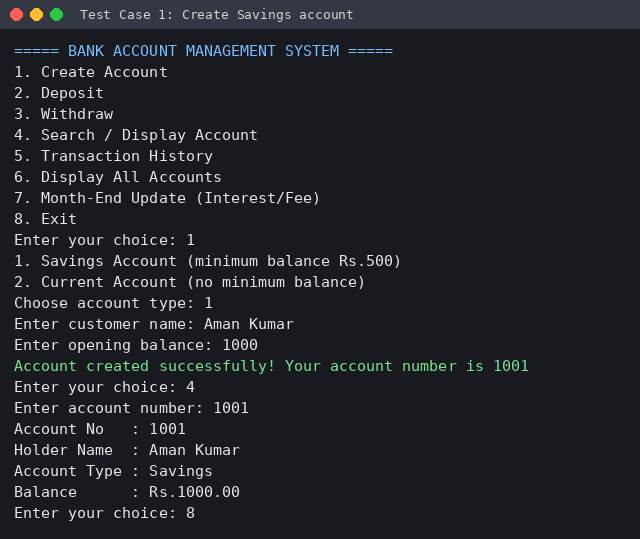
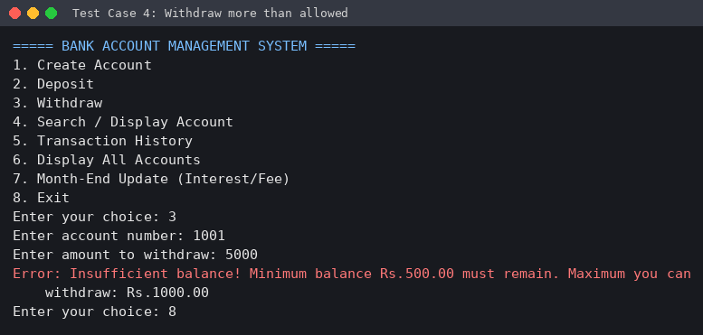

# Bank Account Management System

A console-based C++ application that simulates basic banking operations.
Mini project for **Object-Oriented Programming using C++ (CIC-211)**.


## Features
- Create Savings or Current accounts (account number is generated automatically)
- Deposit and withdraw money with validation
- Savings account must always keep a minimum balance of Rs.500
- Search and display account details
- Transaction history for every account
- Display all accounts
- Month-end update: 0.5% interest for Savings, Rs.50 maintenance fee for Current
- All data is saved in `accounts.txt` and loaded when the program starts

## Class Design
| Class | Purpose |
|---|---|
| `BankException` | Custom exception for banking rule violations |
| `Account` | Abstract base class (balance, deposit, withdraw, history) |
| `SavingsAccount` | Derived class, minimum balance Rs.500, interest |
| `CurrentAccount` | Derived class, no minimum balance, maintenance fee |
| `Bank` | Manages all accounts, menu operations and file handling |

## OOP Concepts Used
| Concept | Where |
|---|---|
| Classes and Objects | `Account`, `SavingsAccount`, `CurrentAccount`, `Bank` |
| Encapsulation | Private `balance`, changed only via `credit()` / `debit()` |
| Constructors | `Account(int, string, double)` and derived constructors |
| Destructor | `Bank::~Bank()` frees memory, `virtual ~Account()` |
| Inheritance | Savings and Current accounts inherit from `Account` |
| Abstract class / Pure virtual functions | `minBalance()`, `type()`, `monthEndUpdate()` |
| Function overriding / Runtime polymorphism | `applyMonthEnd()` calls `monthEndUpdate()` through `Account*` |
| Function overloading | `deposit(double)` and `deposit(double, string)` |
| Exception handling | `BankException` thrown in deposit/withdraw, caught in `Bank` |
| File handling | `saveToFile()` / `loadFromFile()` using `accounts.txt` |
| Vector | `vector<Account*>` and transaction history vector |

## How to Run
Requirement: a C++ compiler (g++) supporting C++11 or higher.

```
g++ bank_management_system.cpp -o bank
./bank
```
On Windows run `bank.exe` instead.

## Files in this repository
- `bank_management_system.cpp` - complete source code
- `screenshots/` - test case outputs
- `README.md` - this file

## Sample Menu
```
===== BANK ACCOUNT MANAGEMENT SYSTEM =====
1. Create Account
2. Deposit
3. Withdraw
4. Search / Display Account
5. Transaction History
6. Display All Accounts
7. Month-End Update (Interest/Fee)
8. Exit
```


## Test Cases and Sample Output
All test cases were run on the program; screenshots are in the `screenshots` folder.

| No. | Test | Screenshot |
|---|---|---|
| 1 | Create Savings account | [test_1.png](screenshots/test_1.png) |
| 2 | Savings below minimum balance | [test_2.png](screenshots/test_2.png) |
| 3 | Deposit | [test_3.png](screenshots/test_3.png) |
| 4 | Withdraw more than allowed | [test_4.png](screenshots/test_4.png) |
| 5 | Negative amount | [test_5.png](screenshots/test_5.png) |
| 6 | Account not found | [test_6.png](screenshots/test_6.png) |
| 7 | Transaction history | [test_7.png](screenshots/test_7.png) |
| 8 | Month-end update | [test_8.png](screenshots/test_8.png) |
| 9 | Data saved in file | [test_9.png](screenshots/test_9.png) |




## Limitations
- No password / PIN for accounts
- Data is stored in a plain text file
- No transfer between accounts

## Future Enhancements
- Money transfer between two accounts with PIN authentication
- GUI or database (SQLite/MySQL) based storage
